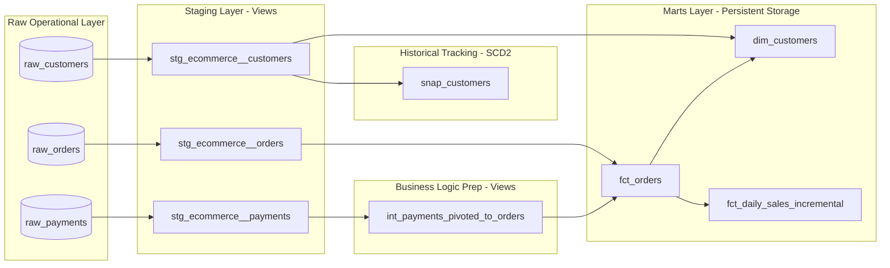

# Enterprise E-Commerce Analytics Platform (dbt + DuckDB)

[](https://github.com/madhumithav30/dbt-ecommerce-pipeline/actions)
[](https://www.getdbt.com/)
[](https://duckdb.org/)
[](https://en.wikipedia.org/wiki/Star_schema)

An end-to-end analytics engineering pipeline transforming raw transactional e-commerce data into audit-ready Kimball dimensional data marts. Built using **dbt**, **DuckDB**, and automated with **GitHub Actions CI/CD**.

---

## Architecture & Data Lineage (DAG)

The project adheres to strict dbt Labs multi-layer modeling conventions: **Staging (Views)** -> **Intermediate (Views)** -> **Marts (Tables/Incremental)**, augmented with **SCD Type 2 historical snapshots**.



---

## Senior Engineering Design Patterns Implemented

### 1. Kimball Dimensional Modeling & Surrogate Key Hashing
* Modeled conformed dimensions (`dim_customers`) and transactional facts (`fct_orders`).
* Decoupled operational system identifiers by generating deterministic surrogate keys via `dbt_utils.generate_surrogate_key`.

### 2. Compute Optimization via Incremental Materialization
* Implemented `materialized='incremental'` on `fct_daily_sales_incremental` using `unique_key='sale_date'` and dynamic partition evaluation.
* Designed with conditional lookback filtering inside `is_incremental()` macros to significantly reduce warehouse I/O and query compute costs.

### 3. Slowly Changing Dimensions (SCD Type 2)
* Built `snap_customers` utilizing dbt's snapshot engine with the `check` strategy to automatically track historical customer metadata mutations (such as email and profile updates) with `dbt_valid_from` and `dbt_valid_to` ranges.

### 4. Metaprogramming with Jinja (DRY Principles)
* Avoided static, repetitive SQL inside `int_payments_pivoted_to_orders` by writing dynamic Jinja loops to pivot transaction methods into metric columns at compilation time.

### 5. Multi-Tier Data Governance & Financial Auditing
* **Contract & Schema Testing:** Enforced `unique`, `not_null`, and `accepted_values` domain constraints.
* **Referential Integrity:** Configured foreign-key `relationships` tests enforcing referential parity between facts and dimensions.
* **Singular Financial Reconciliation Test:** Wrote `assert_order_total_matches_payments.sql` to programmatically fail the pipeline if captured gateway payments deviate from recorded order gross totals.

### 6. Automated CI/CD
* Every pull request and push to `main` triggers a complete end-to-end integration test via **GitHub Actions** (`dbt deps` -> `dbt seed` -> `dbt snapshot` -> `dbt build`).

---

## Local Reproduction & Quickstart

This pipeline runs self-contained locally using an embedded DuckDB instance.

### 1. Prerequisites
* Python 3.9+
* Git

### 2. Environment Setup
```bash
git clone https://github.com/madhumithav30/ecommerce-analytics-dbt.git
cd ecommerce-analytics-dbt

python3 -m venv venv
source venv/bin/activate  # Windows: venv\Scripts\activate
pip install dbt-duckdb
```

### 3. Pipeline Execution
```bash
# 1. Install dependencies
dbt deps

# 2. Ingest raw seed data
dbt seed

# 3. Execute historical snapshots
dbt snapshot

# 4. Compile, run models, and execute all tests
dbt build
```

---

## Verification & Warehouse Inspection

Run the following one-liner to query the customer dimension table from the embedded database:

```bash
python -c "import duckdb; con = duckdb.connect('dev.duckdb', read_only=True); con.sql('SELECT customer_id, first_name, number_of_orders, lifetime_value_usd, customer_lifecycle_stage FROM dim_customers').show()"
```
